# Arquitetura

Como as peças do plugin Butler se encaixam: hooks, o `butler.py` (o "gerente" que não depende de um modelo), a `lib/` que ele chama e o histórico git fora do vault.

## Diagrama

Mostra o caminho de um pedido — sessão → hooks/skills → `butler.py` → `lib/` → histórico git fora do vault — e o caminho só-leitura da skill `consultar`, que nunca passa pela trava. Não detalha as demais skills (`triagem`, `garimpo`, `fila`, `fichar`, `fundir`, `explorar`, `preparar`, `atualizar`, `programas`, `projeto`, `redigir`, `ideia`, `ideia-para-inbox`, `pendencias`) além de onde entram no fluxo, nem o `painel`, que só lê o `estado.json` por fora do plugin.

Este diagrama é do commit `a04ac61d1c`. A fonte é [`arquitetura-visao-geral.diagrama.json`](diagramas/arquitetura-visao-geral.diagrama.json).

A Archify roda fora deste repositório (o candidato não é código do plugin); a imagem vem da exportação "SVG · Claro" do próprio visualizador. O diagrama não acompanha o código sozinho — regerá-lo depois é opcional, não obrigatório a cada mudança.
